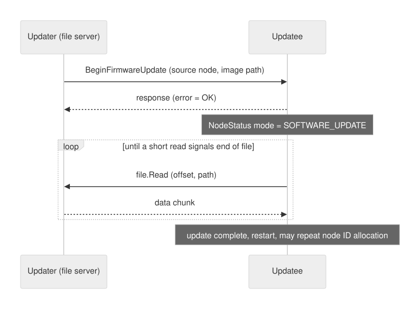
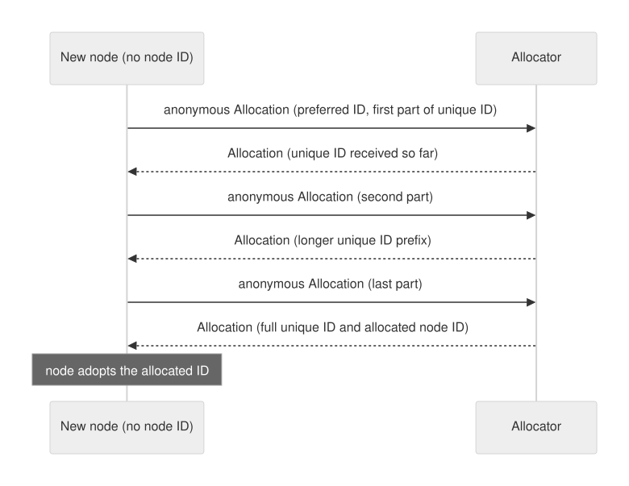

# DroneCAN: A Lightweight Protocol for Highly Reliable Intra-Vehicle Communication in Aerospace and Robotic Applications

**Abstract—** Modern unmanned aerial vehicles (UAVs) and mobile robots are distributed embedded systems in which flight controllers, satellite-navigation receivers, compasses, airspeed sensors, rangefinders, electronic speed controllers (ESCs) and companion computers must exchange data continuously and dependably. Point-to-point interfaces such as PWM, UART, I2C and SPI scale poorly in this setting, whereas the Controller Area Network (CAN) offers differential signalling, priority-based arbitration and built-in error handling, but defines only the two lowest layers of the communication stack. DroneCAN is the open, lightweight application-level protocol that the open-source autopilots ArduPilot and PX4 use on top of CAN; it continues the development of the UAVCAN v0 protocol under a new name. The review proceeds from the bottom up. It summarises the relevant properties of CAN, traces the development from UAVCAN to DroneCAN and Cyphal, and describes the DroneCAN protocol in detail: its peer-to-peer network model without a master node, publish/subscribe and service semantics, the Data Structure Description Language (DSDL), the 29-bit CAN identifier layout, multi-frame transfers, the alternative CAN FD, UDP and MAVLink transports, and the standard application-level functions for node health monitoring, discovery, time synchronisation, configuration, firmware update and dynamic node-ID allocation. The reliability mechanisms are then analysed layer by layer, together with their limits, and DroneCAN is compared with Cyphal, MAVLink and conventional point-to-point interfaces. The presentation is based on the DroneCAN and Cyphal specifications, the PX4 documentation and peer-reviewed literature on CAN, MAVLink and UAV communication. Authentication, quantitative performance evaluation and migration to CAN FD are discussed as open directions.

**Keywords—** DroneCAN, UAVCAN, Cyphal, Controller Area Network, CAN FD, UAV, ArduPilot, PX4, MAVLink, publish/subscribe, reliability, intra-vehicle networks

## I. INTRODUCTION

### A. Background: From Single Controllers to Distributed Systems

A modern unmanned aerial vehicle (UAV, commonly called a drone) is no longer a single controller wired to a few actuators. It is a *distributed embedded system*: several devices, each containing its own processor, cooperate by exchanging data continuously during flight. A typical multirotor combines a *flight controller* (the circuit board that runs the autopilot software) with one or more *GNSS receivers* (satellite-navigation receivers such as GPS), a *magnetometer* (compass), an airspeed sensor, a rangefinder, several *electronic speed controllers* (ESCs, circuits that regulate motor speed), a battery monitor and, optionally, a *companion computer* (an additional computer for high-level tasks such as image processing). The DroneCAN specification describes the processors in such systems as ranging from high-performance on-board computers to extremely resource-constrained microcontrollers [1], and the devices often come from different vendors, which is why the same specification stresses inter-vendor compatibility [11].

The PX4 autopilot illustrates how many components are involved. PX4 requires, as a minimum, a gyroscope, an accelerometer, a magnetometer and a barometer, all of which are integrated in Pixhawk-series flight controllers. External sensors extend this set: a GNSS receiver, or another source of global position, is needed to enable all automatic flight modes, airspeed sensors are highly recommended for fixed-wing and VTOL (vertical take-off and landing) vehicles, rangefinders for all vehicle types, and optical-flow sensors can support navigation without GNSS on multicopters and VTOL vehicles [14]. Each external device therefore adds a power supply, a physical interface and a software driver.

The conventional approach to connecting these devices is *point-to-point wiring*, in which each device is attached to the flight controller through a dedicated port and cable, using the interface that the device provides. In PX4, actuators are driven through PWM, DShot or OneShot outputs (signalling protocols by which a flight controller sends setpoints to motor controllers), which a flight controller typically provides in numbers of six to eight, divided into MAIN and AUX groups [14]. GNSS receivers, safety switches, buzzers and status LEDs are commonly integrated into a single module that is connected to a dedicated port [14]. This arrangement is simple to implement, but it has three limitations. First, the number of ports is determined by the hardware and therefore bounds the number of actuators and sensors that a vehicle can carry; according to the PX4 documentation, the limit of six to eight outputs results from the PWM, DShot and OneShot hardware, whereas a UAVCAN bus is not restricted to such a small number of nodes [14]. Second, each interface type requires its own cabling and driver, which increases the weight, the number of connectors and the number of potential points of failure; reduced wiring and simpler integration of additional hardware are likewise the motivation given by Ravi and El-Sharkawy for using UAVCAN on a UAV [19]. Third, these interfaces do not provide common services such as device discovery, status monitoring or firmware update, which DroneCAN standardises on the bus [9].

Communication faults can have severe consequences: the loss of the link between a sensor and the flight controller can result in the loss of the vehicle, damage to property or injury to people. The communication subsystem must therefore tolerate electrical noise and recover from transmission errors, properties that the Controller Area Network (CAN) provides through differential wiring and built-in error handling [19], [20]. The DroneCAN specification adds further requirements: a network without a master node, support for redundant interfaces and redundant nodes, and low-latency, high-throughput communication [1].

### B. ArduPilot and PX4

An *autopilot* is an embedded computer that runs the software providing control and guidance of an unmanned vehicle. Its key tasks include stabilising attitude and heading, flying missions along waypoints, triggering failsafe actions (predefined reactions to faults, such as returning to the launch point) and connecting to ground control stations [18]. An autopilot is *open source* when its hardware and software designs are publicly accessible and can be modified, which gives such projects flexibility, low cost and the support of a developer community [18].

*ArduPilot* (originally APM) was developed by Jordi Muñoz and Chris Anderson from 2007 within the DIY Drones community, as an offshoot of the Arduino project, and was one of the first open-source autopilots to gain widespread use. It supports multicopters, fixed-wing aircraft, rovers and aquatic vehicles through the vehicle-specific variants ArduCopter, ArduPlane and ArduRover, and it is released under the GNU GPL licence [18]. ArduPilot was initially designed as monolithic software and later moved to the ChibiOS real-time operating system (RTOS), an operating system whose scheduler is designed to meet timing deadlines [18].

*PX4* was initiated by Lorenz Meier in 2008 at ETH Zurich. Its hardware platform, Pixhawk, was released in cooperation with 3D Robotics, and the project is now managed by the Dronecode Foundation. The PX4 software is a modular flight control system that supports multicopters, fixed-wing aircraft, VTOL vehicles, rovers and boats, and it is released under a BSD licence [18]. PX4 runs on the NuttX RTOS [14] and is part of a broader platform that includes the QGroundControl ground station and the Pixhawk hardware [14].

Both projects use the MAVLink protocol (Section I-D) as the primary protocol for communication with ground stations [18]. PX4 additionally uses UAVCAN for communication between onboard components [18]. ArduPilot likewise uses CAN for high-speed communication between onboard components such as GNSS units, sensors and controllers [18]. This role of CAN-based communication is the subject of the following sections.

### C. From CAN to DroneCAN

The Controller Area Network (CAN) was developed by Bosch for the automotive industry to replace complex wiring harnesses with a two-wire *bus*, that is, a shared communication line to which all devices are connected [19], [20]. It is a multi-master, message-broadcast system with a maximum signalling rate of about 1 Mbit/s that offers immunity to electrical noise and the ability to detect and recover from errors [19], [20]. CAN is standardised in ISO 11898, whose part 1 defines the data-link layer and physical signalling and whose part 2 defines the high-speed medium access unit [1]. CAN defines only the data-link and physical layers: it specifies how frames are transmitted, but not how applications name data, assign node addresses, split large data structures across frames or discover other devices. Without an *application-level protocol* that defines these aspects, each vendor would invent its own conventions and interoperability would be lost.

DroneCAN is such an application-level protocol for aerospace and robotic applications. The DroneCAN specification describes it as a lightweight protocol designed to provide a highly reliable communication method for aerospace and robotic applications via the CAN bus, organised as a decentralised peer network in which every node (every device on the bus) has a unique numeric identifier [2]. It is the primary CAN protocol used by the ArduPilot and PX4 projects to communicate with CAN peripherals, and it was created to continue the development of the widely used UAVCAN v0 protocol [12]. The PX4 documentation recommends DroneCAN for most common CAN setups [13].

### D. Related Protocols and Their Relationships

DroneCAN is one of several communication technologies available to UAV designers. *MAVLink* (Micro Air Vehicle Link) is a lightweight messaging protocol for communication between unmanned systems and ground stations and between autopilots and companion computers, and it is used by ArduPilot and PX4 [16], [18]. *Cyphal* is a transport-independent protocol whose primary transport is CAN FD, an extension of CAN for larger frames and higher data rates; the 2025 specification also describes experimental UDP/IP and serial transports [15]. Surveys of UAV communications and of open-source autopilots list these protocols side by side [17], [18].

The relationship between DroneCAN, Cyphal, UAVCAN and MAVLink is easily confused. UAVCAN was the name of the original open protocol for CAN-based communication between the components of a vehicle. In 2022 the project split in two: UAVCAN v0 was renamed DroneCAN, and UAVCAN v1 was renamed Cyphal [13]. DroneCAN is therefore the continuation of UAVCAN v0 and is the CAN protocol used by ArduPilot and PX4 [12], whereas Cyphal is the continuation of UAVCAN v1. The two descendants share design goals, such as a network without a master node and both publish/subscribe and request/response communication [1], [15], but they define different CAN frame formats [4], [15] and are therefore separate protocols, not versions of one another. Publications that predate the split and use the name UAVCAN, such as [19], refer to the protocol that is now called DroneCAN. MAVLink is independent of this lineage: it was released by Lorenz Meier in 2009 [16] and connects the vehicle with ground stations and companion computers, not the components inside the vehicle [16], [18]. The two protocols meet only where DroneCAN frames are carried inside MAVLink 2 messages [6]. Sections IV and VII treat these relationships in more detail.

### E. Organisation

Section II reviews the communication interfaces used on aerial and robotic platforms, and Section III summarises the properties of CAN on which DroneCAN builds. Section IV traces the development from UAVCAN to DroneCAN and Cyphal. Section V describes the design of DroneCAN, and Section VI analyses its reliability and safety mechanisms. Section VII compares DroneCAN with related technologies. Section VIII discusses open challenges, and Section IX concludes.

## II. COMMUNICATION INTERFACES IN AERIAL AND ROBOTIC PLATFORMS

### A. Architecture of a Typical UAV

The autopilot described in Section I-B is realised as flight stack software running on an RTOS on flight controller hardware. Some autopilots also include a general-purpose computer, or a separate companion computer, for higher-level command and control [14]. A *ground control station* (GCS) is the software, such as PX4's QGroundControl, that communicates with the vehicle, typically through a *telemetry radio*, a bidirectional wireless data link [14].

Fig. 1 shows the resulting logical architecture. The flight controller reads sensors, computes actuator commands and communicates with the outside world through several different links.

*Fig. 1. Typical communication links around a flight controller. MAVLink serves the ground station and companion computer; DroneCAN serves intra-vehicle peripherals.*

### B. Point-to-Point Interfaces

**PWM and related actuator protocols.** *Pulse-width modulation* (PWM) encodes a setpoint in the width of the pulses of a periodic signal. In PX4, outputs may be PWM ports or DroneCAN nodes, for example DroneCAN motor controllers [14]. The output ports (MAIN and AUX) are typically six to eight in number because most controllers have only that many PWM, DShot or OneShot outputs [14]. The output ports can use DShot or OneShot in addition to PWM, which offer much lower latency and are relevant for racing and other demanding airframes [14]. A DroneCAN ESC, by contrast, can report its own state: the standard ESC status message carries an error count, voltage, current, temperature and rotational speed [10].

**UART, I2C and SPI.** These are serial interfaces: a UART (universal asynchronous receiver-transmitter) provides a point-to-point serial link, while I2C and SPI are short-distance buses for connecting peripheral chips and modules. In the PX4 documentation, a GNSS module that combines a receiver and a compass is attached to the controller's GPS port, together with the safety switch and the buzzer, and the user-interface LED on recent controllers is typically an I2C peripheral integrated into the same module [14]. An external compass is recommended because it can be made less susceptible to electromagnetic interference than the internal compass of the flight controller [14]. Autopilots also use serial links for telemetry radios and for companion computers, which are connected by a serial cable, an Ethernet cable or Wi-Fi [14].

**Constraints.** Section I-A identified three constraints of point-to-point wiring: the number of ports is fixed by hardware [14], each interface type needs its own driver and cabling, and common services such as discovery, status monitoring and firmware update are not defined by the interfaces themselves. DroneCAN standardises these services on the bus [9].

### C. Higher-Level Links: MAVLink

The Micro Air Vehicle Link (MAVLink) is a communication protocol for unmanned systems that specifies a comprehensive set of messages exchanged between unmanned systems and ground stations [16]. It is a lightweight messaging protocol, released by Lorenz Meier in 2009 under the LGPL, which is designed as a *marshalling library*: it serialises (converts into a sequence of bytes for transmission) messages describing the state of the system and the commands sent to it [16]. ArduPilot and PX4 rely on MAVLink as their primary protocol for telemetry and control [18]. A MAVLink packet consists of a header carrying information about the message and a payload carrying the data [16]. MAVLink is therefore a vehicle-to-ground and autopilot-to-companion protocol, and it is not intended to replace the real-time bus between sensors and actuators inside the airframe. DroneCAN is positioned for that role, and, as Section V-E shows, it can itself be tunnelled over MAVLink [6].

### D. Summary of Requirements

From the discussion above, an intra-vehicle bus for UAVs and robots has to meet the following requirements, which closely match the design goals stated in the DroneCAN specification [1]:

- no single point of failure, and therefore no bus master (a node that controls access for all others);
- a simple way to exchange payloads that exceed a single frame;
- support for redundant interfaces and redundant nodes;
- low latency and high throughput for hard real-time control loops, that is, control loops that must meet strict timing deadlines;
- low computational requirements, down to resource-constrained microcontrollers;
- standard definitions of the high-level functions common to all nodes, such as discovery, configuration and firmware update;
- an open specification with open reference implementations.

## III. THE CONTROLLER AREA NETWORK

DroneCAN inherits most of its physical and link-layer behaviour from CAN. This section summarises the properties that are relevant for the analysis of reliability in Section VI.

### A. Physical Layer and Frame Structure

CAN was developed by Bosch as a multi-master, broadcast communication interface for in-vehicle networks [20]. *Multi-master* means that every node may start a transmission, and *broadcast* means that every transmitted frame can be received by all nodes. CAN uses differential wiring, that is, information is carried by the voltage difference between two wires so that interference acting on both wires cancels out, and two voltage levels: a dominant logic "0" and a recessive logic "1". No dedicated clock line is used; synchronisation is provided through signal edges and *bit stuffing* [20]. The bit-stuffing rule limits the number of repeated bits: after five consecutive bits of the same logic level, the next bit must be the complement, and the transmitter inserts such a complement bit that the receiver removes [20]. The two bus wires, CAN-High and CAN-Low, are terminated with a resistance of about 120 Ω, which prevents signal reflections [19].

In road vehicles, the intra-vehicle network connects approximately 70 electronic control units (ECUs) that exchange around 2500 signals [22]. Five network types are in wide use there: LIN, CAN, FlexRay, Ethernet and MOST. Among them, CAN is the most popular because of its relatively low cost, mature tool chains, acceptable noise resistance and fault tolerance [22]. A typical CAN installation has a bus topology with a baud rate above 125 kbit/s and a 120 Ω terminating resistor at each end of the cable [22]. These properties explain why the same bus has also been adopted for UAV intra-vehicle communication.

A CAN frame carries a start-of-frame bit, an identifier field that also encodes the message priority, the data, a CRC checksum (cyclic redundancy check, a code that allows errors in the data to be detected), acknowledgement bits and end-of-frame bits [19], [20]. Two identifier formats exist: standard CAN uses an 11-bit identifier, which provides 2048 distinct identifiers, and extended CAN uses a 29-bit identifier, which provides about 537 million identifiers; both formats are compatible and can coexist on the same bus [19]. DroneCAN uses only the CAN 2.0B format with 29-bit identifiers, while remaining able to share a bus with protocols based on CAN 2.0A (11-bit identifiers) [4].

### B. Arbitration and Priority

Collisions are resolved by a bit-wise *arbitration* based on the priority encoded in the identifier field: when two nodes start to transmit at the same time, the node with the higher-priority identifier continues and the other node stops [19], [20]. The dominant bit wins, so the numerically lowest identifier has the highest priority [19]. For a safety-oriented protocol, this has an important consequence: the placement of fields in the 29-bit identifier determines which messages pre-empt others. DroneCAN uses this property explicitly by making the 5-bit priority field the first, highest-order field of the identifier (Section V-D) [4].

### C. Error Detection and Fault Confinement

CAN has several built-in mechanisms that make it robust. The start-of-frame bit, the cyclic redundancy check for data integrity, the acknowledgement bits for successful transmission and the end-of-frame bits are the error-checking methods of CAN, and the bit-stuffing rule supports synchronisation [20].

To prevent a faulty node from disturbing the whole network, CAN includes an error-confinement mechanism. Each node maintains a transmit error counter and a receive error counter: the counter increases by eight when an error occurs during transmission and by one when an error occurs during reception. When the counter exceeds 127 the node enters the *error-passive* state, in which its error frames no longer affect bus traffic, and when it exceeds 255 the node enters the *bus-off* state and no longer takes part in bus traffic [20]. In this way a node with a persistent fault eliminates itself from the bus.

### D. CAN FD

Classical CAN carries at most 8 bytes of data in a frame [7] and is limited to about 1 Mbit/s [19], [20]. CAN with flexible data rate (CAN FD) extends the frame to up to 64 bytes and allows the data phase to be transmitted at a higher bit rate than the arbitration phase [7]. DroneCAN defines a CAN FD transport in which the nominal bit rate is usually 1 Mbit/s, with bit-rate switching used to run the data phase at 1, 2, 4, 5 or 8 Mbit/s depending on hardware capabilities [7]. Because only 4 bits are available for the data-length code (DLC), lengths above 8 bytes are quantised to 12, 16, 20, 24, 32, 48 and 64 bytes [7]. Cyphal treats CAN FD as its primary CAN transport, with a single-frame payload (the application data that fits into one frame) of up to 63 bytes, compared with 7 bytes for classical CAN [15].

### E. Security Limitations

CAN was designed in a time when security was not a primary concern; it was used to connect a small number of electronic control units (ECUs) that were not accessible to the end user [20]. The principal weaknesses identified in the literature are the lack of encryption and authentication. Al-Jarrah et al. give the same two root causes: CAN has no message authentication and uses broadcast transmission, so an intruder who gains access to the bus can send messages because nothing verifies their origin [22]. They also note that conventional proactive countermeasures such as encryption and access control may not be applicable to vehicles because of their high connectivity, time sensitivity, resource constraints and complexity, which has directed attention to reactive measures such as intrusion detection systems (IDSs) [22]. Because CAN is a broadcast network, there are no source and destination addresses, every node can listen to every message, and any node can inject frames; CAN is also vulnerable to denial of service, since a malicious node that holds the highest priority and transmits all the time prevents the other nodes from communicating, and the error-confinement mechanism can be abused to force a node into the bus-off state [20]. In an analysis based on the confidentiality–integrity–availability triad, Bozdal et al. conclude that CAN fails all three criteria, and that the proposed countermeasures (network segmentation, encryption, authentication and intrusion detection) each have drawbacks such as bandwidth overhead, latency or incompatibility with standard CAN controllers, so that no solution has been approved by industry and academia [20]. They also point out that protocols implemented on top of the CAN physical layer, such as SAE J1939, can themselves be attacked [20]. These conclusions were reached in the automotive context, but they apply to protocols layered on CAN, including DroneCAN, whose transport layer defines no authentication or encryption fields [4]. Section VI-G returns to this point.

| Property | Classical CAN | CAN FD |
|---|---|---|
| Identifier | 11-bit (2.0A) or 29-bit (2.0B) [19] | 11-bit or 29-bit |
| Data per frame | up to 8 bytes [7] | up to 64 bytes [7] |
| Bit rate | up to about 1 Mbit/s [19], [20] | nominal 1 Mbit/s; data phase up to 8 Mbit/s depending on hardware [7] |
| Arbitration | bit-wise, lowest identifier wins [19], [20] | same |
| Error handling | error counters, error-passive and bus-off states [20] | same |
| Authentication / encryption | none [20] | none |

*Table I. Selected properties of classical CAN and CAN FD.*

## IV. FROM UAVCAN TO DRONECAN AND CYPHAL

### A. Origins

DroneCAN is based on earlier work by Pavel Kirienko and the UAVCAN Development Team, as the DroneCAN specification states [1]. The inheritance is visible in the artefacts of the protocol itself: the root namespace of every standard data type is still `uavcan` (for example `uavcan.protocol.NodeStatus`), the files that define data structures carry the extension `.uavcan`, and the standard configuration parameters share the prefix `uavcan.` [3], [9]. It is also visible in the wording of the definition. Ravi and El-Sharkawy describe UAVCAN in 2019 as a protocol "designed for reliable communication for aerospace and robotic applications via CAN bus" and as a decentralised network in which each node has a unique node identifier [19]; the DroneCAN specification uses the same description for DroneCAN today [2].

Ravi and El-Sharkawy report a UAV integration experiment with UAVCAN. A Pixhawk flight controller running PX4 was connected over a CAN bus to an NXP Rapid IoT board running FreeRTOS (a small real-time operating system for microcontrollers). Two additional UAVCAN messages were defined in the PX4 firmware to carry data in each direction, and a Zubax Babel adapter (a USB-to-CAN interface) together with the UAVCAN GUI tool was used to observe the CAN frames [19]. The motivation was to attach a Thread-based wireless module (Thread is a low-power wireless networking standard) to the flight controller with fewer wires and easier hardware integration. The results are qualitative: frames sent by the autopilot were visible in a terminal, and frames sent by the RTOS board were visible in the GUI tool [19]. The study demonstrates that a second embedded platform can be attached to a PX4 flight controller through UAVCAN.

### B. The 2022 Split

The PX4 documentation records that in 2022 the original UAVCAN project was divided into two separate projects: UAVCAN v0 was renamed DroneCAN, while UAVCAN v1 was renamed Cyphal [13]. The same page recommends DroneCAN for most common CAN setups [13], and the DroneCAN website describes it as the primary CAN protocol used by ArduPilot and PX4 to communicate with CAN peripherals, created to continue the development of the widely used UAVCAN v0 protocol [12]. The name "UAVCAN" in older publications, forum posts and firmware settings therefore usually refers to what is now DroneCAN, whereas the newer Cyphal is a separate protocol. For this reason the name "UAVCAN" is used below only for the historical protocol or when a cited source uses it.

### C. Cyphal

Cyphal is described in its own specification as an open technology for real-time intravehicular distributed computing and communication, based on modern networking standards such as Ethernet and CAN FD, and aimed at manned and unmanned aircraft, spacecraft, robots and cars [15]. Its listed features resemble the DroneCAN design goals: a democratic network without a bus master, publish/subscribe and request/response semantics, automatic decomposition and reassembly of large data structures, support for dual and triply modular redundant transports, network-wide time synchronisation and an interface description language [1], [15]. Version 1.0 of the specification (16 May 2025) records that a physical-layer specification was removed in v1.0-beta (September 2020), that the subject-ID range was reduced from [0, 32767] to [0, 8191], and that Cyphal/UDP and Cyphal/serial transports were introduced in v1.0 [15]. Cyphal/CAN treats CAN FD as the primary transport protocol, supports a maximum node ID of 127, uses eight transfer priority levels, and carries up to 7 bytes in a single classic-CAN frame or up to 63 bytes in a single CAN FD frame [15]. Section VII-A compares these properties with those of DroneCAN in detail.

| Generation | Name (until 2022) | Name (since 2022) | Transports defined in the cited specification | Source |
|---|---|---|---|---|
| Version 0 | UAVCAN v0 | DroneCAN | CAN 2.0B, CAN FD, UDP multicast, MAVLink tunnel | [1], [4]–[7], [13] |
| Version 1 | UAVCAN v1 | Cyphal | CAN (CAN FD primary), UDP (experimental), serial | [13], [15] |

*Table II. Naming and transports of the two protocol generations.*

## V. DESIGN OF DRONECAN

### A. Design Goals and Layered Structure

The DroneCAN specification lists seven core design goals: a democratic network without a master node; automatic transfer decomposition and reassembly for payloads that do not fit into a single CAN frame; support for redundant interfaces and redundant nodes; high-throughput, low-latency communication; simple logic and low computational requirements; clearly defined standard high-level functions; and an open specification with reference implementations under the MIT licence [1]. The same chapter specifies how the standard evolves within a major version: new data types may be added, existing types may be modified only if backward compatibility is preserved, and a type may be declared deprecated, after which it is maintained for at least two more years before its default ID may be reused [1].

The protocol can be understood as the layered structure shown in Fig. 2. Serialised data structures (data converted into a sequence of bytes), defined in the Data Structure Description Language (DSDL), are exchanged by a transport layer that decomposes long transfers into frames [2]. Standard application-level functions are built on top of the standard data types [2].

*Fig. 2. Layered structure of DroneCAN. The alternative transports are described in Section V-E.*

### B. Network Model and Communication Semantics

A DroneCAN network is a decentralised peer network. Every peer (node) has a unique numeric node ID, and nodes communicate by one of two methods [2].

**Message broadcasting** is the primary method and follows *publish/subscribe* semantics: a node publishes data without addressing a particular receiver, and every node that has subscribed to that kind of data receives it. A broadcast message carries the serialised payload, the data type ID, the source node ID and a transfer ID, and typical uses are sensor measurements, actuator commands and equipment status [2]. Nodes that do not yet have a node ID may publish *anonymous messages*, which have no source node ID and are used mainly for initial configuration and dynamic node ID allocation [2]. An anonymous transfer can only be a single-frame transfer [4].

**Service invocation** is a two-step exchange (request/response) between exactly two nodes. The client sends a request, the server acts and sends a response, and typical uses are parameter updates, firmware update, file transfer and ad-hoc action requests [2]. Request and response contain the same values in all fields except the payload, so the client matches a response to its request using the data type ID, the client node ID, the server node ID and the transfer ID [2].

Valid node IDs range from 1 to 127, and the value 0 is reserved for an unknown node or all nodes, depending on the context [4]. The values 126 and 127 are reserved for debugging tools and should not be used for real nodes [8]. Apart from the anonymous case, a message must be sent by a node with a network-unique node ID [4].

Redundant functionality is supported without a special mechanism. Because each published message type has its own data type ID and each node its own node ID, the pair of data type ID and node ID can be used to support redundant nodes with identical functionality inside the same network [2]. Two GNSS receivers publishing the same message type, for example, are distinguished by their node IDs, and a consumer can select between them.

### C. Data Structure Description Language

Message and service structures are defined in the Data Structure Description Language (DSDL). A DSDL compiler generates serialisation and deserialisation code for each target programming language from the definition files. Because the data structure size can be determined statically, the generated code can avoid dynamic memory allocation, which is important for deeply embedded systems with little memory [2], [3].

**Definition files.** Each file defines one data structure for message broadcasting or a request/response pair for a service, and the file name consists of the optional default data type ID and the data type name. The structure lives in a namespace (a named group of definitions that prevents name clashes), and the namespace hierarchy maps onto the file-system directory structure. The standard data types are in the root namespace `uavcan`, and an example is the file `341.NodeStatus.uavcan` in the directory `uavcan/protocol` [3]. The full data type name may not exceed 80 characters [3]. Services use a marker line of three hyphens to separate the request from the response part [3].

**Type system.** Fields may be `bool`, signed (`intX`) and unsigned (`uintX`) integers of 2 to 64 bits, `float16`, `float32`, `float64`, nested structures, and arrays that are either static (`[X]`) or dynamic (`[<X]` or `[<=X]`). Special `voidX` types insert 1 to 64 padding bits for alignment, and a `@union` directive declares a tagged union in which only one field is encoded at a time [3]. Two cast modes control the conversion of a value to a narrower representation: *saturated*, the default, clamps a value that does not fit, while *truncated* drops excess most significant bits for integers [3]. Constants are not transmitted [3].

**Serialisation.** Serialised data are an ordered sequence of bit fields with no header or footer and no implicit alignment. The byte order is little-endian (least significant byte first), and bits are filled from the most significant to the least significant [3]. A dynamic array is normally preceded by a length field of ⌈log₂(X+1)⌉ bits, where X is the maximum number of items. If the array is the last field of the top-level structure and its items are at least 8 bits long, the length field is omitted and inferred from the transfer length, a technique called tail array optimisation (TAO) [3]. TAO is never used on CAN FD [7].

**Compatibility and signatures.** Different nodes can only exchange a structure correctly if their definitions agree. DroneCAN therefore computes a 64-bit *data type signature* from a normalised definition (comments and constants removed, default cast modes made explicit, full names for nested types) with the CRC-64-WE function, a cyclic redundancy check that produces a 64-bit checksum; the computation is extended over the signatures of nested structures. Two data types are compatible if their names and signatures are equal [3]. Constant definitions are deliberately excluded from the signature, because including them would make types non-extensible [3]. An aggregate signature allows two whole sets of types to be compared at once [3].

**Data type IDs.** Message and service types do not share a data type ID space, so a message type and a service type can have the same ID without conflict, and changing an ID does not affect compatibility [3]. The ID space is partitioned by convention. Message type IDs 0–19999 are for standard messages, 20000–20999 for vendor-specific messages and 21000–65535 are reserved. Service type IDs 0–99 are for standard services, 100–199 are reserved and 200–255 are for vendor-specific services [8]. The vendor-specific range is used in practice by projects that extend the standard; for example, the ArduPilot project defines messages in its own `ardupilot.*` namespace, such as `ardupilot.indication.SafetyState` (ID 20000) [10]. Because vendor ranges are prone to collisions, end users must be able to change the ID of any non-standard type on a node [3].

Table III lists a selection of the standard data types that are relevant to a typical UAV. The standard definitions use SI units and follow the right-handed X-forward, Y-right, Z-down body convention, and quaternions are ordered X, Y, Z, W [8].

| Data type | Default ID | Purpose |
|---|---|---|
| `uavcan.protocol.NodeStatus` | 341 | Periodic status and presence of every node [9], [10] |
| `uavcan.protocol.GetNodeInfo` (service) | 1 | Node identification [9], [10] |
| `uavcan.equipment.esc.RawCommand` | 1030 | Up to 20 ESC setpoints, each normalised to [−8192, 8191] [10] |
| `uavcan.equipment.esc.Status` | 1034 | ESC error count, voltage, current, temperature, speed and index [10] |
| `uavcan.equipment.gnss.Fix2` | 1063 | GNSS navigation solution [10] |
| `uavcan.equipment.gnss.RTCMStream` | 1062 | Correction data for high-precision positioning [10] |
| `uavcan.equipment.range_sensor.Measurement` | 1050 | Rangefinder measurement [10] |
| `uavcan.equipment.air_data.TrueAirspeed` | 1020 | Airspeed sensor data [10] |
| `uavcan.equipment.power.BatteryInfo` | 1092 | Battery information [10] |

*Table III. Examples of standard data types and their default data type IDs.*

The ESC messages illustrate the difference from point-to-point wiring. A single `RawCommand` message carries up to 20 setpoints, and each ESC answers with its own `Status` message [10]. An autopilot can thus both command and monitor many ESCs over the same two wires, whereas a PWM output carries a command only (Section II-B).

### D. Transport Layer on CAN

**Transfers.** A *transfer* is an act of data transmission between nodes. A broadcast transfer is addressed to all nodes except the source, and a unicast transfer is addressed to one node. A message transfer is a broadcast transfer that carries a serialised message, and a service transfer is a unicast transfer that carries a request or a response; both can be single-frame or multi-frame [4]. All transfers have a payload (the application data), a data type ID, a priority and a transfer ID [4].

**Timing.** A message transmission should be aborted if it cannot be completed within 1 second. For services, the transmission should be aborted after 1 second, the client should stop waiting for a response after 1 second, and the server should be able to process any request in under 0.5 seconds, unless the application strongly requires different documented values [4].

**CAN identifier layout.** DroneCAN uses only the CAN 2.0B frame format with 29-bit identifiers, and it can share a bus with other protocols based on CAN 2.0A [4]. The 29 bits are used differently for the three transfer kinds, as summarised in Table IV [4].

| Transfer kind | Fields from bit 28 down to bit 0 (width in bits) |
|---|---|
| Message | priority (5), message type ID (16), service-not-message = 0 (1), source node ID (7) |
| Anonymous message | priority (5), discriminator (14), lower bits of message type ID (2), service-not-message = 0 (1), source node ID = 0 (7) |
| Service | priority (5), service type ID (8), request-not-response (1), destination node ID (7), service-not-message = 1 (1), source node ID (7) |

*Table IV. Layout of the 29-bit CAN identifier for the three transfer kinds [4]. In each row the widths add up to 29 bits, so the priority occupies bits 28–24, the service-not-message bit is bit 7 and the source node ID is bits 6–0 (bit positions derived from the field order and widths in [4]).*

The priority is the most significant field. Valid values range from 0 to 31 and 0 is the highest priority, which follows from CAN arbitration, where the lowest identifier wins (Section III-B). The priority value must be identical for all frames of a multi-frame transfer [4]. Among transfers with the same priority, the next field decides arbitration, which for messages is the message type ID. A lower message type ID therefore takes precedence over a higher one (a consequence of the layout and the arbitration rule).

*Worked example (illustrative values).* A node with node ID 42 publishes `NodeStatus` (type ID 341 = 0x155) at an illustrative priority of 16. The CAN ID is (16 << 24) | (341 << 8) | (0 << 7) | 42 = 0x1001552A. For a single-frame transfer with transfer ID 3, the tail byte described below is 1 1 0 00011 = 0xC3. The number 341 is 101010101 in binary, an alternating bit pattern that the specification points to as facilitating automatic bit-rate detection [9].

**Anonymous messages and the discriminator.** CAN does not allow different nodes to transmit frames with different data under the same CAN ID. Regular transfers satisfy this because the identifier contains the source node ID, but anonymous messages all share source node ID 0. DroneCAN therefore inserts a 14-bit *discriminator* filled with random data, for instance 14 bits of the transfer CRC of the message content. Because the discriminator is short, the probability that several nodes emit frames with the same ID but different data is higher than 0.006 %, which the specification calls significant. The protocol therefore requires nodes to abort the transmission of all anonymous transfers immediately when an error is detected on the bus, to avoid a bus deadlock caused by automatic retransmission [4]. Anonymous message type IDs are limited to 0–3, because only the 2 lower bits of the type ID are available [4].

**Tail byte.** The last byte of the data field of every frame is a *tail byte*, which has the fields (from the most significant bit) start of transfer (1 bit), end of transfer (1 bit), toggle bit (1 bit) and transfer ID (5 bits) [4]. For single-frame transfers, start and end of transfer are 1 and the toggle bit is 0. For multi-frame transfers, start of transfer is 1 only in the first frame, end of transfer is 1 only in the last frame, and the toggle bit starts at 0 and alternates [4]. The transfer ID is 5 bits wide, so it takes values from 0 to 31 [4].

**Transfer ID.** Every node keeps a transfer ID map from *transfer descriptors* (transfer type, data type ID, source node ID and, for unicast transfers, destination node ID) to a counter. The counter starts at zero for a new entry, is incremented for every transfer and rolls over to zero after its maximum. Entries unused for at least 2 seconds may be removed. A service response copies the transfer ID of its request [4].

**Multi-frame transfers.** If the payload exceeds the space available in one frame, the sender computes a transfer CRC, prepends it to the payload and sends the data as a sequence of frames, all but the last of which must be completely filled. The frames should be pushed to the bus at once, in order [4]. The CRC algorithm is CRC-16-CCITT-FALSE (polynomial 0x1021, initial value 0xFFFF), and it is computed over the payload prepended with the data type signature in little-endian byte order [4]. The toggle bit alternates so that duplicated frames can be detected [4]. Single-frame transfers are more efficient in throughput and latency, and the specification advises avoiding multi-frame transfers where possible [4].

With 8-byte classic frames, one byte is used by the tail byte, so a single frame carries up to 7 bytes of payload. A multi-frame transfer with an N-byte payload therefore needs ⌈(N + 2) / 7⌉ frames, because the 2-byte CRC is prepended. For example, a 40-byte payload needs ⌈42/7⌉ = 6 frames, whereas a 7-byte payload, such as the 56-bit `NodeStatus`, fits a single frame. These figures are derived from the tail-byte and CRC rules in [3], [4] and [9]; the payload sizes are examples.

**Reception and redundancy.** A receiver keeps a state for every transfer descriptor. It restarts reassembly when it sees a first frame with a suitable transfer ID, or when a transfer ID timeout of 2 seconds has elapsed, and it uses the *transfer ID forward distance* (in the range 0–31) and a half range of 16 to decide whether a new transfer ID is later or earlier than the last one [4]. In configurations with redundant CAN interfaces (several physical connections to separate buses), a node must transmit every outgoing transfer on all available interfaces simultaneously; an exception is a transfer whose payload depends on the interface, such as time synchronisation. The receiver accepts a transfer from another interface only after the previous transfer is more than Tswitch old, where Tswitch must not exceed 2 seconds [4]. Duplicates of the same transfer arriving through different interfaces are thus suppressed, and a failed interface is tolerated without an explicit failover protocol.

**Driver requirement.** Because all frames of a multi-frame transfer share one CAN ID, the CAN driver (the software that controls the CAN hardware) must transmit frames of identical ID in the order in which they entered the transmit queue. The specification warns that some hardware does not do this by default [4].

### E. Alternative Transports

Three further transports are defined for the same transfer-level data model (Table V).

**CAN FD.** DroneCAN operates on CAN FD with a small number of changes from classical CAN: frames can have up to 64 bytes, TAO is never used, and the data length code is quantised [7]. The usual configuration is bit-rate switching with a nominal rate of 1 Mbit/s and a data phase of 1, 2, 4, 5 or 8 Mbit/s depending on hardware capability, and DLC values 9 to 15 map to 12, 16, 20, 24, 32, 48 and 64 bytes [7]. By the same tail-byte arithmetic as above, a single CAN FD frame carries up to 63 bytes of transfer payload (derived value). The specification recommends the `dronecan_dsdlc` compiler for bindings that work with both classical CAN and CAN FD [7].

**UDP.** DroneCAN can be carried over UDP (User Datagram Protocol, a lightweight connectionless internet protocol) using multicast packets, which are delivered to all members of a group of receivers. The default multicast address is 239.65.82.B, where B is the DroneCAN bus number, and the default port is 57732. A packet contains a 16-bit magic number 0x2934 (a constant that identifies the packet type), a CRC-16-CCITT, 16 bits of flags, a 32-bit message ID and the data, all little-endian. The URI (uniform resource identifier) form is `mcast:B` [5].

**MAVLink.** DroneCAN packets can be carried over MAVLink 2 using `CAN_FRAME` or `CANFD_FRAME` messages, whose data are identical to the corresponding CAN or CAN FD transport packets. The URI prefix is `mavcan:` followed by a standard MAVLink URI [6]. This *tunnelling* allows a ground station that speaks MAVLink to reach DroneCAN nodes through the flight controller, for example for configuration and firmware update.

| Transport | Frame / packet size | Addressing and framing | Source |
|---|---|---|---|
| CAN 2.0B | 8 bytes per frame | 29-bit CAN ID, tail byte | [4] |
| CAN FD | up to 64 bytes per frame | same fields, quantised DLC, no TAO | [7] |
| UDP | datagram | multicast 239.65.82.B:57732, magic number 0x2934, CRC-16 | [5] |
| MAVLink 2 | `CAN_FRAME` / `CANFD_FRAME` messages | prefix `mavcan:` | [6] |

*Table V. Transports defined for DroneCAN.*

### F. Standard Application-Level Functions

DroneCAN does not require any specific initialisation: a node may begin working as soon as it is powered up. The only mandatory application-level function is the periodic broadcasting of the node status message, and everything else is optional [9].

**Node status.** Every node broadcasts `uavcan.protocol.NodeStatus` (ID 341), the only data structure that all nodes are required to support [9]. Its fields are the uptime in seconds (32 bits), a health value (2 bits), a mode (3 bits), a reserved sub-mode (3 bits) and a vendor-specific status code (16 bits), which makes 56 bits or 7 bytes in total (the sum of the field widths in [9]). Health takes the values OK (0), WARNING (1), ERROR (2) and CRITICAL (3). Modes include OPERATIONAL, INITIALIZATION, MAINTENANCE, SOFTWARE_UPDATE and OFFLINE. A node may declare itself OFFLINE before it shuts down, so that others need not wait for a timeout [9]. The publication period may vary between 2 ms and 1000 ms, and a node that fails to publish within 3000 ms is considered offline [9]. Because every working node publishes this message at least once per second, the status stream also provides the vehicle-wide health overview that the specification mentions [1], [9].

**Node discovery.** A list of nodes can be built by listening for `NodeStatus`, and detailed information is available through the `GetNodeInfo` service, whose response contains the node status, the software version, the hardware version and a node name. Support for `GetNodeInfo` is highly recommended in every node [9]. The name is a reversed domain name, similar to a Java package name [9]. A `GetDataTypeInfo` service reveals whether a node knows a data type, and whether it publishes, subscribes to or serves it [9].

**Time synchronisation.** DroneCAN supports network-wide time synchronisation with a resolution of up to one CAN bit period (1 µs at 1 Mbit/s) if the hardware timestamps CAN frames, and it still works, with degraded performance, without this support. The algorithm follows the work of Gergeleit and Streich: a *master* periodically broadcasts `GlobalTimeSync`, which contains the exact timestamp of its *previous* transmission, and *slaves* use it to estimate their phase difference to the master. The specification leaves the clock adjustment algorithm to the implementation. If several masters exist, only the master with the lowest node ID is active, and the slaves move to the next master if the active one is silent for Ttimeout [9]. The broadcast period is 40 ms to 1100 ms and the recommended broadcaster timeout is 2200 ms [9].

**Configuration.** The services `param.GetSet`, `param.ExecuteOpcode` (save to non-volatile memory, or erase) and `RestartNode` manage remote configuration. They are recommended but not mandatory [9]. A naming convention with the prefix `uavcan.` covers common parameters: `uavcan.node_id` (zero means unconfigured, which may prompt dynamic allocation), `uavcan.bit_rate` (zero should trigger automatic bit-rate detection), and `uavcan.dtid-X`, `uavcan.pubp-X`, `uavcan.prio-X` and `uavcan.id-X-Y` for data type IDs, publication periods, priorities and instance IDs [9]. A node with more complex configuration needs should use configuration files through the file services [9].

**File transfer and firmware update.** A set of services (`GetInfo`, `GetDirectoryEntryInfo`, `Delete`, `Read`, `Write`) gives access to the file system of a remote node. Firmware update is a special case: the *updater* calls `BeginFirmwareUpdate` on the *updatee*, which, if it accepts, retrieves the firmware image from a file server, usually the updater itself, through `file.Read`, sets its mode to SOFTWARE_UPDATE, and restarts (Fig. 3). The updatee typically then performs dynamic node ID allocation again [9].

*Fig. 3. Firmware update over DroneCAN [9].*

**Debugging and emergency functions.** `debug.LogMessage` and `debug.KeyValue` report events and named values. `AccessCommandShell` offers a remote command shell, and its definition is marked in the specification as subject to change. The `Panic` message lets a node announce an unrecoverable fault. Receivers should wait for at least 3 messages sent at intervals no longer than 500 ms before they take emergency action, and the reason is a text of at most 7 bytes that fits a single frame [9].

**Dynamic node ID allocation.** Because a node needs a unique node ID, DroneCAN defines an allocation procedure that, combined with automatic bit-rate detection, makes *plug-and-play* nodes possible (nodes that join the network without manual configuration). A dynamically allocated ID is not persistent: the node must allocate again at every start [9]. The procedure involves *allocators*, which serve requests and are normally static nodes, and *allocatees*, each of which has a globally unique 128-bit identifier, the same value that it reports in `GetNodeInfo`. The allocators keep an *allocation table* that maps unique IDs to node IDs; it can only grow, unless it is wiped completely [9].

Allocatees use only anonymous single-frame transfers of the message `uavcan.protocol.dynamic_node_id.Allocation`. On classic CAN they therefore send their unique ID in three stages, and the allocator echoes the part received so far in each reply, as shown in Fig. 4. CAN FD frames can deliver the unique ID in one stage [9]. Request intervals are randomised to resolve collisions, similar to CSMA/CD (carrier-sense multiple access with collision detection) [9]. The allocator can use multi-frame transfers, because it has a node ID [9].

*Fig. 4. Dynamic node ID allocation on classical CAN, simplified from [9].*

The network can have zero, one, three or five allocators. With one allocator, allocation stops if it fails. With three or five allocators, the allocators replicate the allocation table using the Raft consensus algorithm of Ongaro and Ousterhout (a method by which several computers agree on a shared state even if some of them fail), so that the network tolerates the loss of one or two allocators, respectively, and continues to serve requests [9]. Only the elected leader processes allocation requests. The Raft log is the allocation table itself, and the default election timeout is randomised between 2000 ms and 4000 ms [9]. The specification advises against mixing dynamic and static nodes, except for the allocators, and gives rules for safe coexistence [9].

## VI. RELIABILITY AND SAFETY MECHANISMS

DroneCAN is described as providing "a highly reliable communication method" [2], yet the specification does not reduce this claim to a single feature. Reliability emerges from mechanisms at several layers, and each layer defends against a different kind of fault. This section analyses them from the wire upwards and then discusses where the protection ends. The analysis is qualitative and is based on the specification and the cited literature.

### A. Overview

Table VI maps the mechanisms to the faults they address.

| Layer | Mechanism | Fault addressed | Source |
|---|---|---|---|
| Physical | Differential signalling, twisted pair, termination | Electrical noise, signal reflections | [11], [19], [20] |
| Physical | Recommended bit rates, sample points, bus and stub lengths | Timing violations on long or stubbed buses | [11] |
| Physical | Overcurrent protection, power isolation between interfaces, parallel connectors | Short circuit, loss of bus power, connector faults | [11] |
| Link | Bit-wise arbitration with priority in the identifier | Collisions, starvation of urgent messages | [4], [19], [20] |
| Link | Frame CRC, acknowledgement, bit stuffing, error frames | Corrupted frames | [20] |
| Link | Error counters, error-passive and bus-off states | Persistently faulty node | [20] |
| Transport | Transfer CRC over signature and payload, toggle bit, transfer ID, timeouts | Corrupted or duplicated multi-frame transfers, incompatible types, lost frames | [3], [4] |
| Transport | Abort of anonymous transfers on bus error | Deadlock caused by identifier collisions | [4] |
| System | Redundant interfaces (up to three), simultaneous transmission | Failure of one bus | [4], [11] |
| System | Redundant nodes distinguished by node ID | Failure of one sensor or computer | [2] |
| Application | Mandatory `NodeStatus`, health code, offline timeout | Silent failure of a node | [9] |
| Application | Redundant allocators with Raft consensus | Failure of the node ID allocator | [9] |
| Application | `Panic` message, time-sync master fail-over | Unrecoverable system fault, loss of the time reference | [9] |

*Table VI. Reliability mechanisms of a DroneCAN system by layer.*

### B. Physical Layer and Hardware Recommendations

The CAN physical layer uses differential signalling on a twisted pair (two wires twisted around each other), which suppresses noise that affects both wires equally, and a bus that is terminated at both ends with about 120 Ω [19], [20]. DroneCAN builds on ISO 11898-2 high-speed CAN for all of its connector types [11]. Chapter 8 of the specification, titled "Hardware design recommendations", adds the following rules that directly target reliability [11].

*Connectors.* Three connector types are defined: a D-Sub DE-9 connector for maximum compatibility with commercial off-the-shelf parts, a circular M8 B-coded 5-pin connector, and a JST GH 4-pin Micro connector. The M8 connector is the default choice. The Micro connector is intended for small and weight-sensitive systems, has a secure positive lock but no shielding, and is explicitly described as not suitable for safety-critical hardware [11]. It is highly recommended to provide two identical parallel connectors per CAN interface so that a device can be daisy-chained (connected in series) without T-connectors, because T-connectors add an extra point of failure, increase stub length (the length of a branch off the main bus) and weight, and complicate harnesses [11].

*Bus power.* Bus-powered devices must protect each power input with an overcurrent protection circuit such as a fuse, so that a short circuit in one device does not bring down the bus supply. Devices with redundant interfaces must prevent direct current flow between the power inputs of different interfaces, and a power source must shut down a failing bus while continuing to supply the remaining ones [11]. The nominal supply is 24 V on the D-Sub and M8 connectors, with at most 500 mA recommended per bus-powered device, and about 5 V on the Micro connector [11].

*Bit rates and bus length.* DroneCAN is bit-rate agnostic in principle, but only the recommended bit rates should be used for compatibility (Table VII). All entries use a stub length of at most 0.3 m, and the bus-length estimates assume that the propagation delay does not exceed 5 ns/m, excluding transceivers [11]. The frame durations in Table VII are derived values and are not taken from the specification: a classical CAN frame with an extended identifier and 8 data bytes has 131 bit times without stuffing, including the 3-bit inter-frame space. A worst-case count of stuff bits for the 118 stuffable bits gives 29 additional bits, so that at most 160 bit times are needed (118 + 29 + 13 trailing bits).

| Bit rate | Sample point (recommended) | Max. bus length [11] | Max. stub length [11] | 8-byte frame, no stuffing (derived) | 8-byte frame, worst-case stuffing (derived) |
|---|---|---|---|---|---|
| 1000 kbit/s | 75–90 % (87.5 %) | 40 m | 0.3 m | 131 µs | 160 µs |
| 500 kbit/s | 85–90 % (87.5 %) | 100 m | 0.3 m | 262 µs | 320 µs |
| 250 kbit/s | 85–90 % (87.5 %) | 250 m | 0.3 m | 524 µs | 640 µs |
| 125 kbit/s | 85–90 % (87.5 %) | 500 m | 0.3 m | 1048 µs | 1280 µs |

*Table VII. Recommended bit rates and physical parameters [11], with derived frame durations for a 29-bit identifier frame with 8 data bytes. The sample point is the position within a bit period at which the receiver reads the bit value.*

These figures allow a rough capacity estimate. At 1 Mbit/s no more than 1 s / 160 µs = 6250 frames per second fit on the bus in the worst case, which carries at most 6250 × 7 bytes = 43.75 kB/s of transfer payload (an upper bound that ignores arbitration losses and is not a measured throughput). A `NodeStatus` message from each of 20 nodes at 1 Hz needs at most 20 × 160 = 3200 bit/s, or 0.32 % of the bus at 1 Mbit/s. Status traffic is therefore small compared with the bus capacity, which remains available for sensor and actuator data. The same calculation shows why DroneCAN recommends avoiding multi-frame transfers where possible [4], since a multi-frame transfer occupies the bus for several frame times.

*Automatic bit-rate detection.* Designers are encouraged to implement automatic bit-rate detection according to CiA 801. DroneCAN makes the simple approach of measuring bit times feasible, because any functioning network exchanges `NodeStatus` at a rate of at least 1 Hz and the CAN ID of that message contains an alternating bit pattern [11]. Together with dynamic node ID allocation this permits plug-and-play nodes [9].

### C. Link Layer

At the link layer DroneCAN inherits the mechanisms of CAN (Section III). *Arbitration* gives deterministic precedence to the most urgent frames and, because DroneCAN places a 5-bit priority at the top of the identifier, the application can decide which transfers pre-empt others [4]. *Error detection* relies on the CRC, the acknowledgement bits and end-of-frame bits, and the bit-stuffing rule, which also keeps the receiver synchronised [20]. *Fault confinement* is provided by the transmit and receive error counters, which move a persistently failing node into the error-passive state and finally the bus-off state, so that it can no longer disturb the bus [20]. The error-confinement mechanism has a drawback: it protects the bus against a failing node, but Bozdal et al. point out that it can also be abused to force a healthy node into the bus-off state [20].

### D. Transport Layer

Several rules in the transport layer complement the link layer.

1. **Integrity of multi-frame transfers.** A CRC-16 protects the reassembled payload, computed over the payload prefixed with the data type signature [4]. As a consequence of this construction, a receiver whose data type definition differs from the sender's computes a different CRC for a multi-frame transfer and rejects it. The signature itself is not transmitted. Because the transfer CRC is prepended only to multi-frame transfers [4], the signature check does not apply to single-frame transfers, so that a type mismatch on a single-frame message is not caught by the transport layer. This follows from the specification text, and it makes careful management of data type IDs and versions more important, as discussed in Section V-C.
2. **Ordering and duplicates.** The toggle bit and the 5-bit transfer ID allow receivers to detect duplicated or missing frames and to tell old transfers from new ones [4]. A 2 s transfer ID timeout lets a receiver resynchronise after a long silence [4]. With only 32 transfer IDs, a very long burst of lost transfers could in principle make an old transfer ID look new, which explains the half-range comparison and the timeout.
3. **Bounded waiting.** Transmissions are aborted after 1 s, clients stop waiting for a service response after 1 s, and servers should answer within 0.5 s [4]. These bounds prevent a failed server from blocking a client indefinitely.
4. **Collision handling for anonymous transfers.** Nodes must abort anonymous transfers immediately when a bus error occurs, to avoid a deadlock caused by automatic retransmission of frames with the same ID but different data [4].
5. **Driver ordering.** The CAN controller driver must preserve the order of frames with identical IDs [4], which makes correct driver implementation part of the reliability argument.

### E. Redundancy

Redundancy is a central design goal [1] and is addressed at three levels.

*Redundant interfaces.* A node can have two or three CAN interfaces, and DroneCAN supports up to three redundant buses [11]. A node must transmit each outgoing transfer on all interfaces simultaneously, and the receiver removes duplicates as described in Section V-D [4]. Because mission-critical and non-critical devices often share a network, the specification gives a topology rule (Fig. 5): each bus is assigned a level of importance (primary or backup), all devices connect to the primary bus, and only devices with redundant interfaces additionally connect to the backup buses [11]. One redundant interface may also be left unused [11]. The PX4 documentation notes that both DroneCAN and Cyphal can use a second, redundant CAN interface [13].

*Fig. 5. Primary and backup bus topology with devices that have different numbers of interfaces, following the rules in [11].*

*Redundant nodes.* Identical sensors can coexist, because every node has its own node ID, and the combination of data type ID and node ID identifies the publisher [2]. How the consumer selects or fuses redundant data is application logic that DroneCAN does not prescribe.

*Redundant services.* The dynamic node ID service can be run with three or five allocators using Raft, tolerating one or two allocator failures [9]. The time-synchronisation function allows several masters, with automatic switch-over to the next master after a timeout [9]. These features remove two potential single points of failure that exist in simple master–slave designs.

### F. Health Monitoring and Emergency Handling

Because every node must publish `NodeStatus`, any consumer can detect the loss of a node: a node that is silent for 3000 ms is considered offline, and a node that intends to shut down can announce this with the OFFLINE mode, which removes the delay [9]. The health field (OK, WARNING, ERROR, CRITICAL) and the mode (for example SOFTWARE_UPDATE or MAINTENANCE) allow consumers to decide whether to trust the data from a node [9]. An uptime counter that goes backwards signals a restart [9]. The `Panic` message provides a network-wide emergency signal, which receivers should act on only after several repeated messages, so that a single corrupted or spurious message does not trigger an emergency action [9]. These functions provide the *detection* of failures, while the reaction is left to the application, for example to the failsafe logic of the autopilot [18].

### G. Limits of the Protection

**No authentication or encryption.** The CAN weaknesses summarised in Section III-E apply to DroneCAN. Every node can listen to all traffic and transmit frames with any identifier. The transport-layer chapters of the specification [4] define no fields for authentication or encryption, and the node ID in the identifier is a claim that is not verified. The review of Ghamari et al. lists UAVCAN together with MAVLink among common UAV protocols that are vulnerable to eavesdropping, man-in-the-middle attacks (an attacker intercepting and possibly altering the communication between two parties), packet injection and denial-of-service attacks [17]. By comparison, MAVLink 2 offers an optional 13-byte signature intended to authenticate messages [16]. Kim et al. recently proposed a protocol-aware intrusion detection system (IDS) for UAVCAN networks [21]. It reassembles UAVCAN transfers and extracts ten features from payload data and from violations of the transfer rules in CAN IDs and tail bytes. On ten attack scenarios from a public dataset, the best configuration reached an average accuracy, precision and recall of 99.89 %, 99.96 % and 99.88 %, and the transfer-rule features were especially effective for replay attacks (re-sending previously recorded valid messages) [21]. These numbers come from a single study on one dataset, but they indicate that the transport-layer fields (CAN ID and tail byte) are a useful source of detection features and that detection, rather than prevention, is the approach pursued in this study.

**Experimental attacks on a DroneCAN bus.** A technical report from the Hacking and Countermeasure Research Lab at Korea University documents attacks on the internal network of a UAV that uses UAVCAN v0, that is, DroneCAN [23]. The testbed is a quadcopter with a Pixhawk 4 flight controller connected over a CAN bus to four ESCs (Holybro Kotleta20, which supports UAVCAN v0), with a 120 Ω terminator at the end of the bus. The terminator was replaced by a CAN shield attached to a Raspberry Pi 4, which could read all frames and transmit frames of the attacker's choice [23]. The injected frames use CAN ID 0x05040601, which identifies `RawCommand` (message type ID 1030), the message that commands the ESCs [23]. Decoded with the identifier layout of Section V-D, this identifier corresponds to priority 5, message type ID 1030 and source node ID 1 (derived). The attacker therefore transmits frames that carry the same identifier as the legitimate commands, which illustrates in practice that the source node ID in the CAN identifier is an unverified claim.

Three injection attacks were implemented [23]. In a *flooding* attack, frames with an all-zero payload are sent at fixed intervals while the transfer ID in the tail byte is incremented, so that the frames conform to the transfer rules. In a *fuzzy* attack, the payload is filled with random values, and the transfer CRC is recomputed for every frame from the data type signature and the payload, so that the frames remain well-formed. In a *replay* attack, previously recorded direction-control frames are retransmitted with their original timing [23]. Because the signature is derived from the publicly available data type definition (Section V-C), the fuzzy attack shows that the transfer CRC protects against accidental corruption only and does not authenticate the sender (derived from the description in [23]).

The reported effects depend on the attack type [23]. Flooding stopped the motors for the duration of the attack. Fuzzy injection disturbed flight intermittently and stopped the motors whenever critical values were injected. Replay caused a continuous movement to one side and made normal control impossible. Ten scenarios of 180–280 s were recorded, in which the attacks lasted 30–50 s each and were separated by periods of normal operation; the attacker's packet generation interval was 0.0015 s or 0.005 s, and the labelled dataset contains the CAN frames of the ten scenarios (for example 91,042 normal and 116,816 attack frames in scenario 1) [23].

**Attack types on CAN-based networks.** Al-Jarrah et al. classify the cyberattacks that intrusion detection research addresses on intra-vehicle CAN networks into five groups [22]. In a *denial-of-service* (DoS) attack, the attacker exploits the arbitration mechanism by sending high-priority messages that force other nodes to stop transmitting; an attacker with limited knowledge can launch it, so its likelihood and impact are rated very high. In a *message injection* attack the attacker sends fabricated but valid messages, and in a *replay* attack it stores a valid message and sends it again later. *Message manipulation* alters or deletes messages, for example after compromising a gateway between two buses. In a *masquerade* attack the attacker compromises two nodes, learns the identifiers and the transmission frequency of one of them, silences it, and uses the other to send messages on its behalf. *Malware* can send malicious messages once it has been introduced through a vulnerable interface [22]. Among the 42 intrusion detection studies reviewed in [22], 69 % addressed injection and replay attacks, 26 % message manipulation, 17 % DoS, 10 % malware and 7 % masquerade attacks.

**Dependence on correct implementation.** The mechanisms depend on correct hardware and firmware. The in-order requirement for the driver [4] and the rules for redundancy [4], [11] are examples where non-compliant hardware or firmware silently undermines the guarantees.

**Dynamic allocation and mixed networks.** Dynamic node IDs are not persistent, so a node can receive a different ID after each restart [9]. The specification therefore advises against mixing static and dynamic nodes, and it gives conditions under which a mix is safe [9]. Consumers that select data by node ID must take this into account.

**Nature of the reliability argument.** The specification chapters state requirements and recommendations, and they contain neither measurements of frame-loss rates nor failover times of redundant buses, and they do not address safety certification. The statements on reliability in this review therefore describe mechanisms by design. The quantitative performance of a particular installation depends on its implementation, wiring and load.

## VII. COMPARISON WITH RELATED TECHNOLOGIES

DroneCAN is not the only way to connect components in an unmanned vehicle, and several of the alternatives operate at different layers. This section compares it with its sibling Cyphal, with MAVLink and with conventional point-to-point interfaces.

### A. DroneCAN and Cyphal

Cyphal and DroneCAN share a heritage and many design goals (Section IV), but they are different protocols with different wire formats. Table VIII compares them using the two specifications.

| Property | DroneCAN | Cyphal (v1.0) |
|---|---|---|
| Origin | UAVCAN v0 [12], [13] | UAVCAN v1 [13], [15] |
| Transports | CAN 2.0B, CAN FD, UDP multicast, MAVLink tunnel [4]–[7] | Cyphal/CAN (CAN FD is the primary transport), Cyphal/UDP (experimental), Cyphal/serial [15] |
| CAN identifier | 29 bits [4] | 29 bits [15] |
| Priority levels | 32 (5 bits) [4] | 8 [15] |
| Node ID range on CAN | 1–127 [4] | up to 127 (7 bits) [15] |
| Message identifiers | 16-bit message type ID (0–65535), 8-bit service type ID [4] | 8192 subject IDs and 512 service IDs [15] |
| Single-frame payload | 7 bytes on classic CAN (derived); frames up to 64 bytes on CAN FD [4], [7] | 7 bytes classic CAN, up to 63 bytes CAN FD [15] |
| Transfer ID on CAN | 5 bits [4] | cyclic, modulo 32 [15] |
| Anonymous transfers | single-frame, 14-bit random discriminator, abort on bus error [4] | supported, non-deterministic collision resolution [15] |
| Type compatibility | 64-bit data type signature (CRC-64-WE) [3] | major and minor versions of data types, up to 256 each [15] |
| Redundancy | up to three redundant CAN interfaces [11] | non-redundant, doubly and triply redundant transports [15] |
| Time synchronisation, DSDL, pub/sub, RPC | yes [1], [2], [9] | yes [15] |

*Table VIII. Comparison of DroneCAN and Cyphal.*

Several differences deserve comment. The identifier space of DroneCAN is larger (65,536 message types against 8192 subjects), and it offers a finer priority scale (32 against 8 levels), whereas Cyphal treats CAN FD as its primary transport and adds UDP and serial transports for non-CAN networks [4], [15]. Cyphal/CAN states that it can share a bus with other high-level CAN protocols only if they do not use CAN 2.0B frames [15]. Since DroneCAN uses CAN 2.0B frames exclusively [4], it follows that DroneCAN and Cyphal/CAN cannot be mixed on one bus and that a vehicle that uses both must separate them on different buses. The PX4 documentation supports using both families side by side but recommends DroneCAN for the most common setups [13]. In practice the choice follows the ecosystem: peripherals and firmware for ArduPilot and PX4 are built for DroneCAN [12], [13], [18], whereas Cyphal is the option when a design needs the higher throughput of CAN FD or a non-CAN transport [15].

### B. DroneCAN and MAVLink

MAVLink and DroneCAN serve different purposes, and in most vehicles both are present. MAVLink is a message marshalling protocol for telemetry and control between unmanned systems, ground stations and companion computers [16]. A MAVLink 2 packet carries a header, a payload of up to 255 bytes, a checksum and an optional 13-byte signature, and its message ID is 24 bits wide instead of 8 bits in MAVLink 1 [16]. MAVLink 1 identifies the vehicle with a 1-byte system ID, which limits one ground station to 254 vehicles [16]. DroneCAN, in contrast, is a bus protocol for components inside the vehicle, with automatic decomposition of long transfers, a decentralised network and a standard set of functions for node monitoring and update [1], [2], [9]. Table IX contrasts them.

| Aspect | DroneCAN | MAVLink |
|---|---|---|
| Typical role | Intra-vehicle bus between flight controller, sensors, actuators [1], [14] | Vehicle–ground station and autopilot–companion computer link [16], [18] |
| Topology | Multi-drop bus, any node can publish, no master [1], [2] | Point-to-point links or telemetry networks with system and component IDs [16] |
| Large data | Automatic multi-frame transfers [2], [4] | Payload up to 255 bytes per packet [16] |
| Integrity | CAN frame CRC, transfer CRC for multi-frame transfers [4], [20] | Packet checksum [16] |
| Authentication | None defined in the transport chapters [4] | Optional message signature in MAVLink 2 [16] |
| Interplay | Can be tunnelled over MAVLink 2 (`mavcan:`) [6] | Carries `CAN_FRAME` / `CANFD_FRAME` messages [6] |

*Table IX. Comparison of DroneCAN and MAVLink.*

The two protocols are therefore complementary. The tunnelling transport in the DroneCAN specification [6] is the point where they meet: a ground station that speaks MAVLink can reach a DroneCAN node through the flight controller.

### C. DroneCAN and Point-to-Point Interfaces

The comparison with PWM, serial and I2C connections can be summarised along the dimensions raised in Section II. A PWM, DShot or OneShot output is a dedicated connection per actuator, so the number of actuators is bounded by the output hardware, typically six to eight on a flight controller [14]. A DroneCAN ESC is a node on a shared bus. The number of nodes is bounded by the 127 node IDs and by the available bandwidth (Section VI-B), not by the number of ports [14], and each ESC also reports its own status [10]. Dedicated interfaces also lack standard definitions for node discovery, firmware update and health monitoring, whereas DroneCAN provides them for all devices that implement it [9]. Point-to-point links, on the other hand, are simpler: they need no bus termination, no node ID configuration and no CAN controller, and a PWM output has a trivially bounded latency. DShot and OneShot are described in the PX4 documentation as lower-latency actuator protocols [14]. Whether a CAN-based actuator link meets the latency requirements of a given airframe has to be assessed for the application.

## VIII. OPEN CHALLENGES AND RESEARCH DIRECTIONS

**Security.** The most evident open issue is the absence of authentication and encryption (Section VI-G). The CAN security literature surveyed by Bozdal et al. concludes that no countermeasure is agreed upon by industry and academia, because each one adds overhead, latency or incompatibility with standard CAN controllers [20]. DroneCAN has limited room for a MAVLink 2-style signature: the single-frame payload on classic CAN is only 7 bytes, so that a signature of the kind that MAVLink 2 appends (13 bytes [16]) would not fit into one frame. CAN FD, with up to 63 bytes of payload per frame, relaxes this constraint [7], although a larger frame uses more bus time. Intrusion detection, such as the protocol-aware approach of Kim et al. [21], does not require a change of the protocol and is therefore the most readily deployable direction. How authentication could be added in a backward-compatible way, for example in a vendor-specific message or at the application level, remains an open design question.

**Quantitative evaluation.** Questions that call for experimental treatment include the end-to-end latency distribution of a control loop (for example from `RawCommand` to the reaction of an ESC) for different bus loads and priorities, the loss and recovery behaviour under electromagnetic interference, the failover time when one of two redundant buses fails, and the bus utilisation of a realistic node mix. The analytic bounds of Section VI-B provide reference values against which such measurements can be compared. A test bench with a flight controller, several DroneCAN nodes and a CAN analyser is sufficient for a first study.

**CAN FD migration.** CAN FD raises the payload per frame to 64 bytes and the data-phase bit rate to as much as 8 Mbit/s [7]. DroneCAN already specifies the necessary changes (no TAO, quantised DLC) [7], but a migration requires transceivers and controllers that support CAN FD and bus layouts that tolerate higher data-phase rates. The operation of mixed networks of classic-CAN and CAN FD nodes is a further design question.

**Coexistence with Cyphal.** Both families use 29-bit identifiers and cannot share a bus (Section VII-A). Vehicles that integrate peripherals of both families need separate buses or gateways.

**Fault isolation on a shared bus.** A shared linear bus has the property that a node that is electrically faulty, or a short circuit in the harness, can affect all devices. The specification mitigates this through redundant buses and power protection [11]; active fault isolation, for example with bus guardians or star couplers, is not part of it.

**Evolution of the specifications.** Both protocols are under active development [1], [15]. The statements in this review refer to the DroneCAN specification as generated on 26 August 2025 and to version 1.0 of the Cyphal specification of 16 May 2025.

## IX. CONCLUSION

DroneCAN is the open, lightweight application-level protocol that ArduPilot and PX4 use on top of CAN to connect flight controllers with sensors, actuators and other peripherals. It descends from UAVCAN v0 and was renamed in 2022, when the UAVCAN v1 branch became Cyphal [13]. Its design combines a decentralised publish/subscribe and request/response model, a compact data description language with signatures, a transport layer that hides multi-frame transfers behind 29-bit identifiers with a priority field, and a standard set of functions for monitoring, discovery, time synchronisation, configuration, firmware update and dynamic node ID allocation [1]–[4], [9].

The reliability of the system results from the combination of several mechanisms: differential signalling, arbitration, error confinement and CRC inherited from CAN [20]; transfer-level checks, bounded waiting and redundant interfaces defined by DroneCAN [4]; hardware rules for connectors, power and bus length [11]; and application-level health reporting, redundant allocators and emergency signalling [9]. These mechanisms protect against noise, corrupted frames, failed nodes and failed buses. They do not protect against a malicious participant, because CAN and the DroneCAN transport define no authentication or encryption, which is the principal open problem [20], [21].

Compared with Cyphal, DroneCAN offers a larger identifier space and a finer priority scale on classic CAN frames, whereas Cyphal emphasises CAN FD and additional transports [4], [15]. Compared with MAVLink, it addresses the communication inside the vehicle and not the link to the ground station [16]. Compared with point-to-point interfaces, it removes the dependence on the number of hardware ports and adds standard services for discovery, status monitoring and firmware update [9], [14]. Quantitative studies of latency, loss and failover behaviour on a test bench with redundant buses are a natural continuation of this analysis.

## REFERENCES

[1] DroneCAN Development Team, "1. Introduction," in *DroneCAN Specification*. Accessed: Oct. 2026. [Online]. Available: https://dronecan.github.io/Specification/ (page generated 26 Aug. 2025).

[2] DroneCAN Development Team, "2. Basic concepts," in *DroneCAN Specification*. [Online]. Available: https://dronecan.github.io/Specification/

[3] DroneCAN Development Team, "3. Data structure description language," in *DroneCAN Specification*. [Online]. Available: https://dronecan.github.io/Specification/

[4] DroneCAN Development Team, "4.1 CAN bus transport layer," in *DroneCAN Specification*. [Online]. Available: https://dronecan.github.io/Specification/

[5] DroneCAN Development Team, "4.2 UDP bus transport layer," in *DroneCAN Specification*. [Online]. Available: https://dronecan.github.io/Specification/

[6] DroneCAN Development Team, "4.3 MAVLink bus transport layer," in *DroneCAN Specification*. [Online]. Available: https://dronecan.github.io/Specification/

[7] DroneCAN Development Team, "4.4 CANFD bus transport layer," in *DroneCAN Specification*. [Online]. Available: https://dronecan.github.io/Specification/

[8] DroneCAN Development Team, "5. Application level conventions," in *DroneCAN Specification*. [Online]. Available: https://dronecan.github.io/Specification/

[9] DroneCAN Development Team, "6. Application level functions," in *DroneCAN Specification*. [Online]. Available: https://dronecan.github.io/Specification/

[10] DroneCAN Development Team, "7. List of standard data types," in *DroneCAN Specification*. [Online]. Available: https://dronecan.github.io/Specification/

[11] DroneCAN Development Team, "8. Hardware design recommendations," in *DroneCAN Specification*. [Online]. Available: https://dronecan.github.io/Specification/

[12] DroneCAN project, "DroneCAN: a lightweight protocol for aerospace and robotic applications," project website. Accessed: Oct. 2026. [Online]. Available: https://dronecan.github.io/

[13] PX4 Autopilot Project, "CAN (DroneCAN & Cyphal)," in *PX4 User Guide*. Accessed: Oct. 2026. [Online]. Available: https://docs.px4.io/

[14] PX4 Autopilot Project, "Basic concepts," in *PX4 User Guide* (main branch). [Online]. Available: https://docs.px4.io/

[15] OpenCyphal Development Team, *Cyphal Specification v1.0*, rev. 16 May 2025. [Online]. Available: https://opencyphal.org/specification

[16] A. Koubâa, A. Allouch, M. Alajlan, Y. Javed, A. Belghith, and M. Khalgui, "Micro Air Vehicle Link (MAVLink) in a nutshell: A survey," *IEEE Access*, vol. 7, pp. 87658–87680, 2019, arXiv:1906.10641.

[17] M. Ghamari, P. Rangel, M. Mehrubeoglu, G. S. Tewolde, and R. S. Sherratt, "Unmanned aerial vehicle communications for civil applications: A review," *IEEE Access*, vol. 10, pp. 102492–102531, 2022, doi: 10.1109/ACCESS.2022.3208571.

[18] N. Aliane, "A survey of open-source UAV autopilots," *Electronics*, vol. 13, no. 23, Art. no. 4785, 2024.

[19] N. Ravi and M. El-Sharkawy, "Integration of UAVs with real time operating systems using UAVCAN," in *Proc. IEEE 10th Annu. Ubiquitous Comput., Electron. Mobile Commun. Conf. (UEMCON)*, 2019, pp. 600–605, doi: 10.1109/UEMCON47517.2019.8993011.

[20] M. Bozdal, M. Samie, and I. Jennions, "A survey on CAN bus protocol: Attacks, challenges, and potential solutions," in *Proc. Int. Conf. Comput., Electron. Commun. Eng. (iCCECE)*, Southend, U.K., Aug. 2018, doi: 10.1109/iCCECOME.2018.8658720.

[21] S. Kim, H. Im, J. Choi, and S. Lee, "Protocol-aware feature-based intrusion detection system for UAVCAN networks," *Sensors*, vol. 26, no. 19, Art. no. 6061, 2026, doi: 10.3390/s26196061.

[22] O. Y. Al-Jarrah, C. Maple, M. Dianati, D. Oxtoby, and A. Mouzakitis, "Intrusion detection systems for intra-vehicle networks: A review," *IEEE Access*, vol. 7, pp. 21266–21289, 2019, doi: 10.1109/ACCESS.2019.2894183.

[23] D. Kim, Y. Song, S. Kwon, H. Kim, J. D. Yoo, and H. K. Kim, "UAVCAN dataset description," Hacking and Countermeasure Research Lab, Korea University, arXiv:2212.09268v2 [cs.CR], Apr. 2024. [Online]. Available: https://arxiv.org/abs/2212.09268